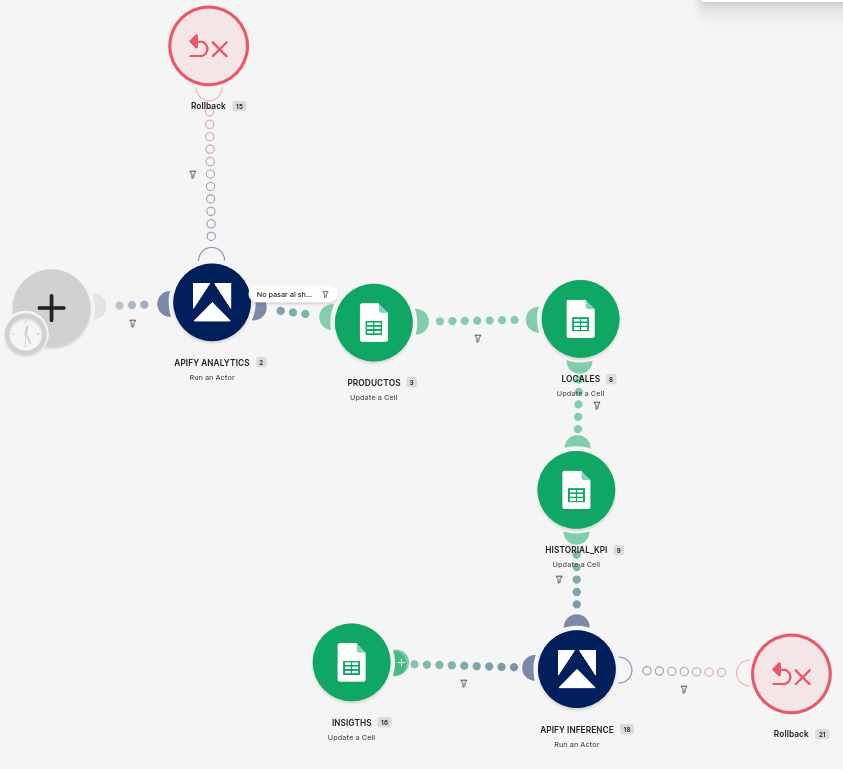

# Radar Sin TACC


**Inteligencia de compra de insumos sin TACC para locales gastronómicos de Salta, Jujuy y La Rioja.**

Proyecto Capstone · Samsung Innovation Campus 2026 · Inteligencia Competitiva
Equipo **DataPatitos**: Valentina (Business Analyst) · Jose (Data Scientist) · Natanahel (Solution Engineer)

---

## 1. El problema

La Ley 26.588 (reglamentada por el Decreto 218/2023) exige que restaurantes, bares y comercios gastronómicos ofrezcan al menos una opción sin gluten. Para cumplirla, un café, restaurante o panadería de **Salta, Jujuy o La Rioja** tiene que comprar harinas, fideos, premezclas, rebozadores y pan sin TACC, y hoy no tiene una forma simple de saber **cuánto es un buen precio**.

En Mercado Libre el precio de estos insumos varía mucho y es difícil de comparar: hay publicaciones sin el peso en el título, packs que dicen "x12" con el precio de una sola unidad y envases de tamaños muy distintos. Un ejemplo de nuestros datos: fideos Matarazzo x6 a **$25.499**, cuando el precio esperado para ese peso y ese pack es de **$54.859**.

**Datos** (extracción del 12/11/2026 con Apify):
- **831 publicaciones de Mercado Libre** en 5 categorías (fideos, harina, pan, premezcla, rebozador): 748 de trabajo (90 %) y 83 reservadas (10 %).
- **407 locales de Google Maps** en las capitales de las tres provincias: 366 de trabajo y 41 reservados. Solo 11 declaran ofrecer opciones sin TACC en su nombre o categoría.

Lo que **no** medimos: cuántas personas celíacas no encuentran dónde comer, ni si comer sin TACC cuesta más. El radar hace visible la oferta y los precios.

## 2. La solución

**Radar Sintacc Noa** es un Actor de Apify con dos operaciones, orquestado con Make, que alimenta una app de AppSheet:

| Producto | Operación | Qué responde |
|---|---|---|
| 1 · Analytics | `analytics` | ¿Cuánto cuesta por kilo cada insumo? ¿Cuánto se ahorra comprando por mayor (de 6 % en pan a 42 % en fideos)? ¿Dónde hay locales con y sin oferta sin TACC? |
| 2 · Inference | `inference` | ¿**Qué conviene comprar, que además sea seguro**? Un semáforo que compara cada precio con el **precio esperado por el modelo**, la **validación contra el listado oficial de ANMAT** y el **costo de cada plato sin TACC** |

**Semáforo de compra** (831 publicaciones):

| Color | Significado | Cantidad |
|---|---|---|
| 🟢 Verde | 25 % o más por debajo del precio esperado: oportunidad de compra | 61 |
| 🟡 Amarillo | Precio acorde a lo esperado | 608 |
| 🔴 Rojo | 33 % o más por encima del precio esperado: cara | 51 |
| ⚪ Revisar | El peso no figura en el título (93) o el precio por kilo está fuera de rango (18): no se recomienda | 111 |

Los cortes son simétricos: pagar 0,75 veces lo esperado es el espejo de pagar 1,33 veces (1 ÷ 0,75).

**Las publicaciones dudosas no se borran**, se marcan como "revisar". Un precio extraño no es necesariamente un error: puede ser una publicación mal armada o un precio anómalo que conviene mirar. Por eso preferimos mostrarlo apartado en lugar de eliminarlo.

**Barato y seguro (validación ANMAT):** que el título diga "sin TACC" lo escribe el vendedor. Cada publicación se cruza con el **Listado Integrado de Alimentos Libres de Gluten de ANMAT** (descarga del 23/11/2026: 25.703 productos vigentes de 4.679 marcas). Primero se busca la marca en el título; después, que las palabras clave del producto coincidan con un producto registrado de esa marca.

| Nivel | Qué significa | Publicaciones |
|---|---|---|
| ✅ Validado | Marca y producto en el listado oficial | 205 |
| 🔎 Verificar | La marca tiene productos autorizados, pero este no se encontró | 436 |
| ❌ No figura | La marca no está en el listado | 190 |

**Se recomienda solo lo que es verde y está validado: 25 publicaciones "baratas y seguras"**, de las 61 verdes.

**Kit "Menú Sin TACC"** (la idea que nos sugirió Juan): para 5 platos base calcula el costo del insumo sin TACC por porción, con el precio típico y con la mejor opción barata y validada. Esa opción sale como una publicación concreta para comprar.

| Plato | Costo típico por porción | Con el radar | Comprar |
|---|---|---|---|
| Fideos con salsa | $2.610 | $1.056 | Fideos Matarazzo mix de legumbres |
| Milanesa rebozada | $661 | $435 | Rebozador Sturla de garbanzo y lino |
| Pizza individual | $1.318 | $1.049 | Premezcla universal Delicel |
| Masa de tarta | $515 | $214 | Harina de arroz Dicomere |
| Sándwich | $3.838 | $3.838 | Sin opción barata y validada: precio típico |

Con 2 porciones por día de cada plato, el local pasa de **$536.520 a $395.520 por mes** en insumos sin TACC: **$141.000 menos (26 %)**. Es un ahorro potencial. Las porciones y cantidades son supuestos editables (`reglas.RECETAS`).

Además, el modelo de Google Maps compara las reseñas reales de cada local con las esperadas. Así marca los locales más populares de lo esperado (11) como clientes potenciales a los que conviene ofrecerles los insumos.

## 3. Flujo automático (Make)



1. **APIFY ANALYTICS**: corre el Actor con `operation: analytics` (ETL + EDA) y publica `productos.csv`, `locales.csv` e `historial_kpi.csv`.
2. **Filtro `status = SUCCEEDED`** y **Rollback**: si el Actor falla, el escenario frena y no toca la Sheet.
3. **PRODUCTOS, LOCALES, HISTORIAL_KPI**: actualizan cada pestaña de Google Sheets (`IMPORTDATA`, con un parámetro de tiempo que obliga a recargar en el momento).
4. **APIFY INFERENCE**: corre el Actor con `operation: inference`, que carga los modelos y calcula el semáforo.
5. **INSIGHTS** y **MENU**: actualizan la pestaña del semáforo (con la validación ANMAT) y la del menú.
6. **AppSheet** lee la Sheet y la app se actualiza sola.

Corre **una vez por semana** (programado) o a mano. Usa 6 operaciones por corrida, dentro del plan gratis de Make.

## 4. La demo

Video de la demo: **[COMPLETAR: link al video]**
Link visualización de la App (AppSheet) - requiere iniciar sesión con una cuenta autorizada: https://www.appsheet.com/start/cba1284d-0643-41e3-b487-2e9ecff2e803?platform=desktop#appName=RadarSinTACC%C2%B7DatosautodesdeApify-467717521&vss=H4sIAAAAAAAAA62OvQrCMBRG3-Wb8wRZxUFEHRQX0yE2txBsk9Ikagl5d2_9QVyL4_0u53AyrpZu-6jrC-Qpf681jZDICoexJwWpsPAuDr5VEApb3b3GXe-HmJw12lBQKCiV-EgiBcg8wyH_0CFgDbloG0vDJJxwFr1hfk8oDz8gikCXoj639OxnsBTeGl-nQObIUXNjwsot7712ZuMNexvdBioPmH-VkH4BAAA=&view=Oportunidades 

La app (AppSheet) muestra:
1. **Oportunidades de compra:** las publicaciones en verde, con el precio real, el precio esperado y el motivo en una frase (por ejemplo "54 % más barato que lo esperado para su peso, pack y categoría").
2. **Precio por kilo** mayorista y minorista por categoría, y los productos más vendidos.
3. **Mapa** de locales de Salta, Jujuy y La Rioja en tres colores: sin TACC confirmado, solo por búsqueda y sin oferta.
4. **Publicaciones a revisar:** lo dudoso, para que el local no compare mal.

## 5. Código del Actor de Apify

El Actor es **solo de inferencia**: no entrena ni incluye un batch iterator. `main.py` solo arma el Actor, y la lógica está en módulos aparte. Los datos se leen por el SDK de Apify (no desde un Drive) y los modelos se cargan desde una carpeta del repo. Cumple las cuatro reglas de la cátedra (R1 a R4), y los tests de GitHub las controlan en cada cambio: ver [`docs/lineamientos.md`](docs/lineamientos.md).

```
sintacc-actor/                  el Actor (es lo único que entra al build de Apify)
├── .actor/                     actor.json, input, output y vistas del dataset
├── src/
│   ├── main.py                 solo arma el Actor (entrada, push_data, set_value)
│   ├── extraer.py              lectura de datos por el SDK de Apify
│   ├── etl_ml.py, etl_maps.py  limpieza y features (ETL)
│   ├── parseo.py               peso y pack desde el título
│   ├── muestra.py              90 % de trabajo / 10 % reservado (semilla 42)
│   ├── eda.py                  indicadores del dashboard
│   ├── modelo.py               carga de los modelos y predicción
│   ├── inferencia.py           semáforo de compra y popularidad de locales
│   ├── anmat.py                validación contra el listado oficial de ANMAT
│   ├── menu.py                 kit "Menú Sin TACC": costo por plato
│   ├── salida.py               filas del dataset e historial
│   └── reglas.py               reglas de negocio (umbrales, correcciones, categorías)
├── modelos/                    modelo_ml.pkl y modelo_maps.pkl (entrenados en el Colab)
├── scripts/                    carga de los CSV a Apify (se corre fuera del Actor)
└── tests/                      63 tests: parseo, controles contra el Colab, modelos, semáforo y reglas R1 a R4
entrenamiento/                  comparación de los 5 modelos candidatos (fuera del Actor)
docs/                           lineamientos R1 a R4 y captura de Make
```

**Operaciones e input:**

```json
{ "operation": "analytics", "source": "csv", "csvStore": "<ID del store con los CSV>" }
{ "operation": "inference", "csvStore": "<ID del store con los CSV y el listado ANMAT>" }
{ "operation": "inference", "metodo": "mediana" }
```

La tercera forma es el plan B sin modelo: compara contra la mediana de la categoría. El detalle técnico (input, output, API, costos, decisiones de datos) está en [`sintacc-actor/README.md`](sintacc-actor/README.md).

**Costo:** USD 0,007 por corrida de `analytics` y USD 0,005 por corrida de `inference`. Corriendo una vez por semana son unos USD 0,05 por mes, dentro del crédito gratis de Apify.

## 6. Métrica de negocio

> **Reducir el costo por kilo** que paga un café, restaurante o panadería de Salta, Jujuy y La Rioja por sus insumos sin TACC, con un semáforo de compra que marca como oportunidad las publicaciones de Mercado Libre que están 25 % o más por debajo de su precio esperado. Se mide en **pesos de ahorro por kilo** y se reporta como **ahorro potencial**.

- **Indicador:** diferencia entre el precio real y el esperado (`diferencia_pct`).
- **KPI:** ahorro por kilo de las publicaciones en verde (`ahorro_por_kg`).
- **Umbral:** verde con −25 % o menos; rojo con +33 % o más.
- **Acción:** el local compra la oportunidad en lugar del precio normal.

**Ahorro potencial de las 61 oportunidades** (mediana por categoría):

| Categoría | Oportunidades | Precio por kilo | Esperado por kilo | Diferencia | Ahorro por kilo |
|---|---|---|---|---|---|
| Fideos | 15 | $9.228 | $18.286 | −33 % | $5.646 |
| Harina | 26 | $5.275 | $8.459 | −31 % | $2.399 |
| Premezcla | 9 | $8.740 | $11.915 | −30 % | $3.161 |
| Rebozador | 8 | $10.107 | $17.662 | −37 % | $6.331 |
| Pan | 3 | $36.805 | $55.543 | −37 % | $20.338 |

**Importante:** es un ahorro **potencial**, no demostrado. Lo verde sale más barato porque se eligió por barato. La prueba real sería un piloto con un local que compre siguiendo el semáforo durante un mes.

### Retorno de la inversión (ROI)

Con los datos de la ficha del cliente: 3 personas, 12 horas por semana relevando precios a mano a USD 8 por hora, o sea unos USD 416 por mes. Inversión de USD 2.500 más USD 150 por mes. Si se automatiza todo el relevamiento, el neto es de unos USD 266 por mes y la inversión se recupera en unos **9,4 meses** (12,7 meses si quedan 2 horas por semana de revisión). No incluye el ahorro en insumos, que depende de cuántos kilos compra cada local.

## 7. Métrica del modelo

El modelo principal estima el **precio esperado** de cada publicación según su peso total, las unidades del pack, la categoría, el envío gratis y el descuento. El objetivo está en logaritmo, así que el R² se lee como variación porcentual explicada. Se reporta además el error en pesos.

**Cinco candidatos** (pedido de la cátedra), con el mismo preprocesamiento. Se comparan con validación cruzada de 5 partes **dentro del 90 % de trabajo**. Cada candidato se evaluó una sola vez en el 10 % reservado, y la elección se hizo por validación cruzada, no por el 10 %:

| Candidato | R² (validación) | MAE (validación) | R² (10 % reservado) | MAE (10 %) | RMSE (10 %) |
|---|---|---|---|---|---|
| Clásico 1 · Ridge | 0,793 | $7.015 | 0,694 | $6.055 | $11.317 |
| Clásico 2 · Árbol de decisión | 0,820 | $5.966 | 0,770 | $4.666 | $7.868 |
| **Ensamble 1 · Random Forest (en el Actor)** | 0,840 | $5.088 | **0,744** | **$4.565** | **$8.177** |
| Ensamble 2 · Gradient Boosting | 0,845 | $5.067 | 0,730 | $4.615 | $7.773 |
| Red · MLP | 0,763 | $7.337 | 0,646 | $8.531 | $27.887 |

- **Por qué no se usa accuracy:** es una regresión (un precio), no una clasificación. Por eso se mide con R² y con el error en pesos (MAE y RMSE).
- **Resultado:** el Random Forest y el Gradient Boosting quedan prácticamente empatados en la validación: 0,005 de R² y $21 de MAE de diferencia, menos que lo que varía entre particiones. Los dos superan el umbral de 0,70 en el 10 % reservado.
- **Decisión final (DS): Random Forest.** Una diferencia de 0,005 de R² está dentro del ruido entre semillas, así que los datos no justifican cambiar de modelo. El Random Forest se eligió como desempate porque ya está exportado, reproduce en el Actor el R² del Colab y es el mejor en Google Maps. La decisión no se tomó con el 10 % reservado, que se usó solo para reportar. (`entrenamiento/resultados.json` marca como "mejor" al Gradient Boosting porque el script desempata solo por el R² de validación).
- **Para el cliente:** el modelo explica cerca del 74 % de la variación del precio en publicaciones que nunca vio, y se equivoca en promedio unos $4.565 por publicación.
- **Modelo complementario (Google Maps, reseñas):** gana el Random Forest. R² de validación 0,768; en el 10 % reservado, R² 0,891, MAE de 242 reseñas y RMSE de 861 reseñas (Ridge: RMSE 1.677).

**Dos comparaciones, mismo ranking.** Los números de esta tabla salen del repo (`entrenamiento/comparar_modelos.py`): Ridge como clásico 1 y validación cruzada de 5 partes. El Colab de Jose usa otro protocolo: regresión lineal y particiones 70/30 con 10 semillas. Ahí da en Mercado Libre Gradient Boosting 0,839 y Random Forest 0,829, y en Maps Random Forest 0,770, con un MAE de 240 reseñas en el 10 % y un RMSE de 865 (lineal: 1.708). Las diferencias chicas (0,768 contra 0,770, 242 contra 240, 861 contra 865) son esperables por el cambio de protocolo. En los dos, los ensambles quedan arriba y prácticamente empatados.

**Validación de variables:** en Mercado Libre `peso_total_kg` es la que más explica: sin ella el R² baja de 0,78 a 0,43. `envio_gratis` y `descuento_pct` entran por criterio de negocio: su aporte propio es casi nulo, pero no empeoran el modelo.

**Reproducibilidad:** semilla 42; el 10 % reservado se separa antes de cualquier análisis; el Actor reproduce los datos del Colab (mismos controles y R² 0,744 con el modelo exportado); scikit-learn 1.6.1 fijo. Código de la comparación en [`entrenamiento/`](entrenamiento/).

## 8. Limitaciones

- **Una sola fecha (12/11/2026):** todavía no hay histórico de precios para avisar de una "baja". El Actor ya acepta una extracción nueva (`source: apify`) con el extractor de Mercado Libre; falta programarla para acumular semanas.
- **El modelo vio el 90 % al entrenar:** en esas publicaciones el precio esperado se parece más al real que en datos nuevos, así que el semáforo es conservador (marca menos verdes y rojos de los que marcaría con publicaciones nuevas).
- **Peso desde el título:** 93 de 831 publicaciones no dicen el peso y se estima con la mediana de su categoría. Esas quedan en "revisar".
- **Valores extremos:** 20 de 831 publicaciones (16 en el 90 % de trabajo) tienen un precio por kilo fuera de los límites de su categoría.
- **Validación ANMAT por título:** Mercado Libre no trae la marca ni el RNPA, así que el cruce es por las palabras del título. Es prudente a propósito: si no está seguro, deja la publicación en "verificar" y no la recomienda. La confirmación final es el RNPA del envase.
- **Locales:** solo capitales, y Jujuy concentra el 73 %. Solo 11 de 407 declaran sin TACC; las reseñas miden popularidad, no ventas.

## 9. Próximos pasos

1. Cruzar por RNPA (el número del envase) para pasar de 205 a más productos validados.
2. Programar extracciones semanales para construir el histórico y avisar las bajas de precio por mail o WhatsApp.
3. Clasificar con IA las reseñas de los locales "solo por búsqueda" para confirmar si son aptos.
4. Hacer entrevistas a 5 o 10 locales para medir cuántos kilos compran y cuánto pagarían.

## 10. Equipo

| Rol | Persona | Aporte |
|---|---|---|
| Business Analyst | Valentina | Problema, dashboard y app, métrica de negocio, ROI, pitch |
| Data Scientist | Jose | Limpieza, EDA, validación de variables, modelos |
| Solution Engineer | Natanahel | Actor de Apify, escenario de Make, Google Sheets, tests y repo |

**Fuentes:** Ley 26.588 y Decreto 218/2023 (argentina.gob.ar); Mora et al., Revista Argentina de Salud Pública (2010).
